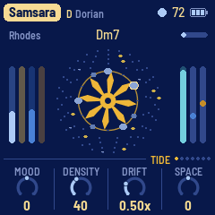
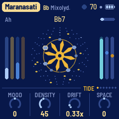
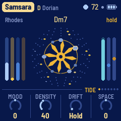

# SAMSARA for the M-VAVE FM-1

SAMSARA turns the M-VAVE FM-1 into a slow ambient piece that plays itself and changes over hours, in the spirit of
Brian Eno's *Reflection*: a breathing pad, soft bells, a gliding bass and a rare low ground that come and go like
weather, through a tape echo and a wandering plate. Tone, harmony and density drift; every so often the whole piece
ebbs nearly to silence and returns. It never repeats and never stands still, unless you turn Drift fully down, which
holds the moment you are in.

  

**SAMSARA is a fork of [AMB-1](https://github.com/charlesvestal/fm1-amb) by Charles Vestal** (from its version 1.3.2:
[UPSTREAM.md](UPSTREAM.md)), by Tomorrow's Man. The sounds (the pad, the bells, the bass, the echo, the plate), the
pages and the whole platform are AMB-1's. SAMSARA's own part is the conductor over them: the weather, the tide, the
seasons, the wandering harmony and tone, a loudness governor, the ground layer, the first page's four knobs and the
wheel on the screen. It was built under the working name **TIDE**; the source's comments and
[ARCHITECTURE.md](ARCHITECTURE.md) still call it that.

- **The manual**: [docs/MANUAL.md](docs/MANUAL.md)
- **The firmware file**: [releases](https://github.com/tomorrowsman/fm1-samsara/releases)

Installing it is at your own risk, though it's hard to get stuck: M-VAVE's own firmware can be put back, and an FM-1
that fails to start twice comes up in a safe mode an installer can reach (the manual, Troubleshooting). SAMSARA keeps
its pieces in its own place in the FM-1's memory and leaves AMB-1's alone.

## In short

| | |
|---|---|
| HOME page, KNOB 1–4 | **Mood** (dark to bright), **Density**, **Drift** (the pace of all change; fully down: Hold), **Space** (near to far) |
| PRESETS | The piece: Samsara, Maranasati, Anatta, Nirvana |
| Keys | The scale: each key adds its note or takes it out |
| PLAY · REC · EDIT | Grow / rest · freeze · the next chord |
| ENV · ARP · LFO · SEQ · FX · GLO | The other pages: Pad, Bells, Bass, Ground, Space, Setup |
| SELECT | The previous or next page; with HOME held, the tempo |
| ALGORITHM | The home mode |
| OCT− / OCT+ | The bells' octave; both for 5 seconds: update mode |
| SAVE | Saves; held, puts the piece back to its recipe |

Hold any button for a second and a card says what it does. SAMSARA also tells the
[FM-1 Screen Reader](https://charlesvestal.github.io/fm1-reader/) what its screen shows, as AMB-1 does.

## Building and testing

SAMSARA is an app on [fm1-base](https://github.com/charlesvestal/fm1-base), which is in this tree as a plain folder
(`base/`, with felucca-bsp in `base/bsp/`; their commits are in [UPSTREAM.md](UPSTREAM.md)). The toolchain and
prerequisites are in [BUILDING.md](BUILDING.md):

```
sh tests/run_tests.sh                                      # the instrument, the app in a simulator, the web builds
./build.sh                                                 # app/build/samsara.fwsc (Linux, or GitHub: BUILDING.md)
python3 base/tools/fm1_install.py app/build/samsara.fwsc   # install it over USB
```

`app/build/host/samsara_host SCRIPT OUTDIR` runs the whole app on a computer from a script
(`tests/scenarios/*.amb`), with audio and screenshots coming out. `./build.sh --web` builds the same code for the
browser (the emulator).

## Credits

SAMSARA stands on AMB-1 by Charles Vestal, and every credit of AMB-1's stands here. The idea comes from Brian Eno's
generative music: *Music for Airports*' tape loops of unequal length, the echo chain of *Discreet Music*, the
endlessness of *Reflection*. The reverb is Jon Dattorro's plate ("Effect Design, Part 1", JAES 1997), as in
[FoMni-1](https://github.com/charlesvestal/fm1-fomni). AMB-1 and SAMSARA are built on
[fm1-base](https://github.com/charlesvestal/fm1-base) and [felucca-bsp](https://github.com/hugelton/felucca-bsp),
from [Felucca](https://github.com/hugelton/Felucca) by Leo Kuroshita (Hügelton Instruments). The idea of running
FM-1 firmware in the browser comes from [Groove OS](https://www.groove-os.com/). MPL-2.0; see
[LICENSING.md](LICENSING.md).

M-VAVE and FM-1 are trademarks of their owners. SAMSARA is not affiliated with M-VAVE, Brian Eno, Charles Vestal or
Hügelton Instruments.
