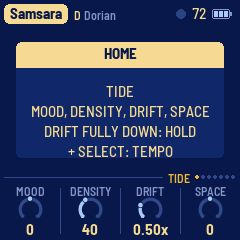
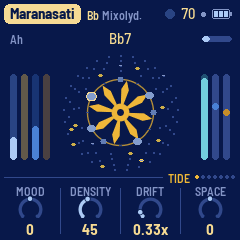
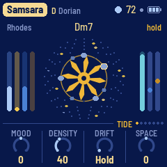
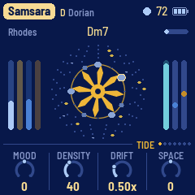
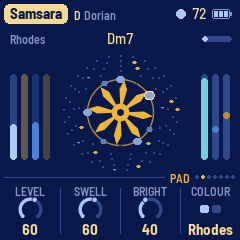
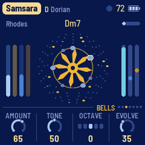
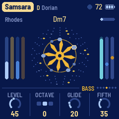
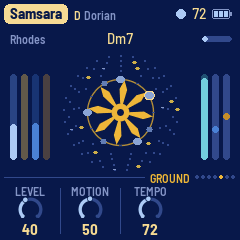
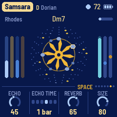

# SAMSARA

SAMSARA turns your M-VAVE FM-1 into a slow ambient piece that plays itself and changes over hours, in
the spirit of Brian Eno's *Reflection*. Switch it on and it begins: a breathing pad, soft bells, a
gliding bass and, now and then, a low ground under them, through a tape echo and a wandering plate
reverb. Tone, harmony and density drift like weather. Every so often the whole piece ebbs, nearly
to silence, and comes back. It never repeats and it never stands still, unless you ask it to.

SAMSARA is a fork of [AMB-1](https://github.com/charlesvestal/fm1-amb) by Charles Vestal: its sounds
and its platform, under a new conductor. See [Credits](#s12).

, running SAMSARA, each control labeled")

---

## Contents

1. Install
2. Getting started
3. Controls
4. The screen
5. How it moves
6. The pieces
7. The pages
8. MIDI
9. Saving
10. Troubleshooting
11. Parameters
12. Credits

---

## 1. Install

SAMSARA has no web installer of its own yet; it installs from the command line, over USB.

1. Download `samsara-X.Y.fwsc` from the [releases page](https://github.com/tomorrowsman/fm1-samsara/releases).
2. Get the source (`git clone https://github.com/tomorrowsman/fm1-samsara`) and Python 3 with
   `pip3 install mido python-rtmidi`.
3. Connect the FM-1 with a USB data cable, switch it on, and run:

   ```
   python3 base/tools/fm1_install.py samsara-X.Y.fwsc
   ```

   It says what is on the FM-1 now and what it is about to write, and asks before it writes. Don't
   unplug the FM-1 while it's writing. When it's done, the FM-1 restarts into SAMSARA.

To go back to M-VAVE's firmware, use "Back to the stock firmware" at the bottom of
[AMB-1's web installer](https://charlesvestal.github.io/fm1-amb/install/) (Chrome or Edge): download
the FM-1 V15 file from the link there, choose it and press the button. M-VAVE's own updater,
M-UPGRADE, works too, and so does the command above with M-VAVE's file.

> Installing other firmware is at your own risk. If the FM-1 ever won't start, see
> [Recovering an FM-1 that won't start](#recovering-an-fm-1-that-won-t-start).

SAMSARA keeps its pieces in its own place in the FM-1's memory. Installing it does not touch what
AMB-1 (or DUB-1, NACHTFAHRT or AISLING, which share AMB-1's place) saved, and they do not touch
SAMSARA's.

---

## 2. Getting started

SAMSARA starts playing as soon as you switch it on. Try this:

1. **Listen.** The first piece, Samsara, begins in D Dorian. Turn MASTER to set the volume. Give it
   time: it is made for hours, and the first minutes are only where it starts.
2. **Try another piece.** Turn PRESETS. Each of the four pieces has its own key, tempo, sounds and
   pace.
3. **Turn the four knobs.** On the first page (HOME) they are **Mood** (darker or brighter),
   **Density** (how much is going on, and how loud), **Drift** (how fast everything changes) and
   **Space** (near and dry, or far and wet). All four sit at a middle that is the piece as written.
4. **Hold a moment you like.** Turn Drift all the way down. The screen says "hold", and the piece
   stays in the state it is in: the same chord, the same voices, the same tone, for as long as you
   leave it there. Turn Drift up and it moves on from where it was.
5. **Change the scale.** Press a key whose note is lit to take that note out, so nothing plays it.
   Press it again to bring it back. Press a key that isn't lit to add its note.
6. **Move on.** Press EDIT, and the pad moves to the next chord at the start of the next bar.
7. **Freeze.** Press REC to hold the chord and let the reverb ring on, while the bells go on above
   it. Press REC again to let it go.
8. **Rest.** Press PLAY, and the piece stops growing while its sounds fade out. Press PLAY again
   and it grows back.

Each piece keeps what you change. SAMSARA saves by itself while it rests, or you can press SAVE.

To find out what a button does, hold it for a second to see a card. Let go and nothing happens.

---

## 3. Controls

The drawing at the top shows every control. Here they are in more detail.

| Control | What it does |
|---|---|
| Keys | The keys are the scale, and they light up for the notes in it. Press a key to add its note or take it out. Every octave of a note is the same key. The root always stays, and the scale keeps at least three notes. |
| PLAY | Grows or rests the piece. SAMSARA starts growing by itself when you switch it on. When it rests, the sounds fade out and the reverb rings away. PLAY is lit while it grows. |
| REC | Freezes the chord. The reverb rings on, while the bells go on dry above it. Press REC again to thaw. It's lit while frozen. |
| EDIT | Moves to the next chord at the start of the next bar, or right away while resting. |
| HOME | Opens the Tide page: Mood, Density, Drift, Space. |
| ENV · ARP · LFO · SEQ | Open the layers' pages: Pad, Bells, Bass and Ground. |
| FX · GLO | Open the Space and Setup pages. The lit button shows which page you're on. |
| SELECT | Turns to the previous or next page. To change the tempo from any page, hold HOME and turn SELECT. |
| ALGORITHM | Picks the home mode: Ionian, Dorian, Phrygian, Lydian, Mixolydian, Aeolian, or pentatonic major or minor. It loads the mode's scale. Once you change the scale with the keys, it's Custom. |
| PRESETS | Picks the piece. For the list, see [The pieces](#s6). |
| KNOB 1–4 | Set the four values on the screen. A few clicks always move one step at a time, and a quick turn speeds up, so half a turn sweeps the whole range. |
| OCT− / OCT+ | Move the bells down or up an octave, up to two either way, from any page. Both held for 5 seconds: update mode. |
| MASTER | Sets the volume. |
| SAVE | Saves all four pieces. Hold it for 1.5 s to put the piece back to its recipe. |

To find out what a button does, hold it for a second (any button but PLAY), and a card explains it.
A key, a knob or another button puts the card away, and letting go does nothing else.



---

## 4. The screen

")


- The top line shows the piece and the key and mode **as they are now**. The harmony leaves home
  over the hours, a note at a time, so this changes as the piece plays. On the right are a slow
  beat light (a play triangle while resting), the tempo (EXT when it follows MIDI clock), a dot
  when there are unsaved changes, and the battery. Messages such as "ADDED F#" and "NEXT CHORD"
  show here for a moment.
- The battery shows three bars when it's full, and fewer as it runs down. At one bar or none it
  turns red, and it's time to charge. When it's plugged into a computer, it shows a lightning bolt
  instead.
- Under it, on the left, is the name of the pad's tone as it is now (it wanders between six), in
  the middle the chord's name, and on the right a thin bar that fills on the way to the next
  chord. Frozen, it says "held"; with Drift fully down, "hold".
- **The wheel** in the middle is the Wheel of Samsara: eight gold spokes and a hub. Its rim is the
  ring of the twelve notes, C at the top: notes in the scale are lit, the chord's notes larger, and
  the root has a ring around it. The wheel turns one spoke for each chord, so it stands still while
  the piece is held. Its gold dims as the tide goes out.
- Around the wheel are the four bell loops, 13, 17, 23 and 29 steps long, from the inside out.
  Each dot is a step, and the gold ones hold a note. A playhead goes round each loop and glows when
  it rings a bell.
- On the left are the four layers' levels as they sound: pad, bells, bass and ground.
- On the right are three slim columns. The first is **the tide**: full when the piece is in, and
  sinking as it ebbs. The other two each carry one mark: where the weather's brightness is, and
  where its density is. The marks move over minutes; the middle is the knob's own place.
- At the bottom are the page's name and seven dots, one for each page, then its four values, one
  for each knob. The one you're turning lights up.



---

## 5. How it moves

SAMSARA grows four layers from one scale and one chord.

- The **pad** is up to three voices at a time: a choir, a filtered Rhodes or sung voices. Each voice enters
  slowly, swells and sinks on its own slow walk, stays for a while and dissolves. Sometimes three
  sing, sometimes one, and sometimes the pad rests altogether for minutes.
- The **bells** are FM bells, softly struck, on four loops of unequal length (13, 17, 23 and 29
  steps), so the melody never quite repeats. They come in passages and let up between them. When
  they are nearly alone they turn rounder, closer to a plucked string, and high notes are softer
  than low ones.
- The **bass** plays the chord's root, low and gliding, and sometimes leans on the fifth. It comes
  and goes like the pad.
- The **ground** is rare: the chord's root an octave under the bass, entering over a minute or
  two, staying a few minutes and leaving, with long gaps between visits.

Over them, things move on four timescales:

- **Seconds to minutes:** each voice's own breathing. No level changes faster than a slow swell;
  nothing arrives suddenly except a bell's strike.
- **Minutes:** the weather. Brightness, density, register and space each wander, and the layers
  come and go. One sustained layer always sounds: the piece may grow very quiet, but something is
  always there.
- **Tens of minutes:** the tide. Every quarter to half an hour or so the whole piece ebbs, far down,
  for a few minutes, and returns. The return is quicker than the leaving.
- **Hours:** the seasons. The pad's tone travels between six characters, and the harmony leaves its
  home key one note at a time, by way of chords the old and new scales share, and wanders back.

Then comes the space: a tape echo with two heads, and a plate reverb whose decay slowly wanders,
so a held note breathes in it instead of standing.

A governor listens to the whole and keeps it near the loudness the Density knob asks for: it turns
a loud mix down, and lets a quiet one be quiet.

---

## 6. The pieces

Turn PRESETS to choose one of four pieces. Each is a recipe for the whole: the layers, the sounds,
the tempo, key and mode, and its pace. Each one remembers how you left it. To put the piece you're
on back to its recipe, hold SAVE for 1.5 s. Tune, MIDI out and Lights are shared by all the pieces.

| Piece | What it is |
|---|---|
| **Samsara** | D Dorian, 72. All four layers, the choir pad, at half speed. The piece everything else was built around. |
| **Maranasati** | Bb Mixolydian, 70. Sung voices and a bass sharing the weight, sparse bells, the slowest weather of the four. |
| **Anatta** | G Lydian, 84. A brighter Rhodes, busier bells, a light ground. |
| **Nirvana** | E pentatonic major, 64. The choir pad, dark round bells in long echoes and the largest room; no ground. |

Each began from one of AMB-1's recipes: Garden, Tides, Afternoon and Shoreline.

---

## 7. The pages

Seven pages, each with its own button and up to four values on KNOB 1–4. Turn SELECT to step
through them in this order.

### HOME: Tide



- **Mood** goes from −50 (dark) to +50 (bright); 0 is the piece as written. It leans the pad's
  tone, the bells' tone, and which way the harmony tends to wander: toward darker modes or brighter
  ones.
- **Density** sets how much is going on and how loud the whole is meant to be: how many pad voices,
  how many bell notes.
- **Drift** sets how fast everything changes, shown as a speed: 1.00x at the middle, 0.25x near
  the bottom, 4.00x at the top. **Fully down is Hold:** nothing moves on until you turn it up.
- **Space** goes from −50 (near and dry: less echo and reverb, a shorter decay) to +50 (far and
  wet); 0 is the piece as written. It works around the Space page's own values without changing
  them.

### ENV: Pad



- **Level** sets the pad's volume.
- **Swell** sets how far the voices breathe.
- **Bright** opens the pad's filter. With Voices, it also moves the vowel.
- **Colour** picks Rhodes, Voices or Choir. Each piece keeps its own. The Choir sings an octave lower than
  the other two.

### ARP: Bells



- **Amount** sets how many bells there are and how loud, together. At 0 there are none.
- **Tone** goes from round and softly struck to a long metallic clang.
- **Octave** moves the bells up to two octaves down or up. OCT− and OCT+ do the same.
- **Evolve** sets how often a loop's notes change as it comes round. At 0, the loops keep their
  notes.

### LFO: Bass



- **Level** sets the bass's volume.
- **Octave** puts the bass one octave down, at home, or one octave up.
- **Glide** sets how slowly the bass slides to its next note, from a quick step to over a second.
- **Fifth** sets how often the bass leans on the fifth, halfway through a chord.

### SEQ: Ground



- **Level** sets the ground's volume. At 0 it never comes.
- **Motion** sets how far the small things wander: the pad voices' places in the stereo field and
  their tone, and the echo's heads.
- **Tempo** goes from 30 to 120. You can also hold HOME and turn SELECT from any page. The tempo is
  the bells' and the echo's clock; the weather has its own (Drift).

### FX: Space



- **Echo** sets how much goes to the echoes.
- **Echo time** sets the tape loop's length: a dotted quarter, a half, a dotted half, or 1, 2 or 4
  bars. At slow tempos, it's shortened to fit the loop's 5.6 seconds.
- **Reverb** sets how much goes to the plate.
- **Size** sets how long the plate rings, and how many times the echo comes back.

### GLO: Setup


- **Root** sets the home key's root note, and the scale moves with it.
- **Tune** fine-tunes SAMSARA by up to 50 cents either way.
- **MIDI out** turns MIDI out on or off.
- **Lights** has three settings. With On, the keys light the scale, and the unlit buttons glow
  dimly so you can find them on the black FM-1. With Keys, only the keys light. Off turns the
  lights off.

The top right of this page shows how much of the FM-1's time the sound takes: **CPU** as it is now
and **PK**, the highest it has been since switching on. If the load ever comes near the limit,
SAMSARA thins itself before the sound can break up (fewer bells at once, then fewer pad voices),
and the page says **THIN** while it does.

---

## 8. MIDI

MIDI comes in over USB and the TRS jack, and goes out over USB.

- A note on channel 1 adds its note to the scale or takes it out, like a key.
- When MIDI clock comes in, SAMSARA follows its beat, and start and stop start and stop the piece.
  The screen shows EXT for the tempo.
- MIDI out is on by default. The pad plays on channel 1, the bells on 2, the bass on 3 and the
  ground on 4. When SAMSARA runs on its own tempo, it also sends clock, start and stop. Turning
  MIDI out off sends all notes off.

### Screen reader

SAMSARA can tell a screen reader what its screen shows. Connect the FM-1 by USB, open
[FM-1 Screen Reader](https://charlesvestal.github.io/fm1-reader/) in Chrome or Edge, and click
Connect. It reads out the page you're on and its knobs, a knob's value as you turn it, the piece
and its key as it is now, the notes you add or take out, help cards, every message, the chord each
time the piece moves on, "holding" at Hold, and "The tide is out" during an ebb.

---

## 9. Saving

SAMSARA keeps all four pieces in the FM-1's memory, each as you left it: the knobs, the scale,
the tempo, the pad's sound and the bells' octave, plus Tune, MIDI out and Lights.

- SAMSARA saves by itself a few seconds after a change, but only while it rests. Writing to the
  memory interrupts the sound for a moment, so it never saves while the piece grows. A dot at the
  top of the screen means there are unsaved changes.
- Press SAVE to save now, whether it's playing or not.
- Hold SAVE for 1.5 s to put the piece back to its recipe. That isn't saved until the next save,
  so if you switch off before then, your version comes back.

Where the piece has wandered to (the weather, the harmony's place away from home) is not saved:
each time you switch on, it starts from home and goes somewhere else.

---

## 10. Troubleshooting

To put the FM-1 in update mode from a running SAMSARA, hold OCT− and OCT+ together for 5 seconds;
the screen counts down. At power-on, hold REC while you switch it on. If you installed m-bootloader
with the web installer, the installer can reach the FM-1 from there, and holding PLAY instead
opens m-bootloader's recovery menu. Without m-bootloader, REC at power-on starts the chip's own
update mode, which only the rescue below can reach.

If a button or knob does the wrong thing, calibrate the panel. Hold OCT− and OCT+ while you switch
the FM-1 on, and the screen asks you to press each button and turn each knob in turn.

If SAMSARA crashes, it shows a red CRASH screen and restarts by itself a few seconds later. The
next start shows RESTARTED AFTER A CRASH and an address (PC ...) for a moment. If you report the
problem, include that address and what you were doing.

If SAMSARA crashes twice in a row while starting, it starts in SAFE MODE instead. There's no sound,
but USB works, so the web installer can reach it. Reinstall SAMSARA, or put the stock firmware back
from the same page. Press PLAY to try starting normally again. If even safe mode fails twice, the
FM-1 drops into the chip's own update mode, and only the rescue below can reach it.

### Recovering an FM-1 that won't start

An FM-1 in the chip's own update mode shows a blank screen, and neither the web installer nor
M-VAVE's updater can see it. A script from felucca-bsp can put M-VAVE's firmware back, on a Mac or
a Linux machine (there is no Windows version), with the USB cable you already have.

Open Terminal, paste this line and press Return:

```
bash -c "$(curl -fsSL https://raw.githubusercontent.com/hugelton/felucca-bsp/main/tools/fm1_rescue.sh)"
```

1. If a window asks to install the command line developer tools, click Install. When it has
   finished, paste the line again.
2. If it asks for a password, type your password (nothing shows as you type) and press Return.
3. When it says it's waiting, plug the FM-1 in and switch it on. The script catches it, checks the
   chip, saves a backup of the FM-1's memory in the `fm1-rescue` folder in your home folder, and
   asks before it writes anything.
4. Type **yes** and press Return. Don't unplug anything until it says it's restarting the FM-1.
   The FM-1 then starts into its original firmware, and you can install SAMSARA again from there.

The script downloads M-VAVE's FM-1 V15 firmware and JieLi's flash loader, and checks both against
known fingerprints. It writes only the firmware area of the memory, never the bootloader or the
FM-1's own settings, and checks everything it writes. If the FM-1 never shows up at all, Felucca's
[FM-1-transporter](https://github.com/kurogedelic/FM-1-transporter) (a small RP2040 board wired to
the USB lines) can still reach it.

---

## 11. Parameters

The defaults are Samsara's; each piece has its own.

| Page | Value | Range | Samsara |
|---|---|---|---|
| Tide | Mood | −50 – +50 | 0 |
| Tide | Density | 0–100 | 40 |
| Tide | Drift | Hold, 0.25x – 4.00x | 25 (0.50x) |
| Tide | Space | −50 – +50 | 0 |
| Pad | Level | 0–100 | 60 |
| Pad | Swell | 0–100 | 60 |
| Pad | Bright | 0–100 | 40 |
| Pad | Colour | Rhodes, Voices, Choir | Choir |
| Bells | Amount | 0–100 | 65 |
| Bells | Tone | 0–100 | 50 |
| Bells | Octave | −2 – +2 | 0 |
| Bells | Evolve | 0–100 | 35 |
| Bass | Level | 0–100 | 45 |
| Bass | Octave | −1 – +1 | 0 |
| Bass | Glide | 0–100 (20 ms – 1.2 s) | 20 |
| Bass | Fifth | 0–100 | 35 |
| Ground | Level | 0–100 | 40 |
| Ground | Motion | 0–100 | 50 |
| Ground | Tempo | 30–120 | 72 |
| Space | Echo | 0–100 | 45 |
| Space | Echo time | 1/4., 1/2, 1/2., 1 bar, 2 bars, 4 bars | 1 bar |
| Space | Reverb | 0–100 | 65 |
| Space | Size | 0–100 | 80 |
| Setup | Root | C – B | D |
| Setup | Tune | −50 – +50 cents | 0 |
| Setup | MIDI out | Off, On | On |
| Setup | Lights | Off, On, Keys | On |
| ALGORITHM | Mode | 8 modes, or Custom | Dorian |

---

## 12. Credits

SAMSARA is by Tomorrow's Man. It is a fork of **AMB-1** by Charles Vestal
(<https://github.com/charlesvestal/fm1-amb>, from version 1.3.2): the pad, the bells, the bass, the
echo and the plate, the pages and the whole platform under them are AMB-1's. What SAMSARA adds is
the conductor (the weather, the tide, the seasons, the wandering harmony and tone, the governor),
the ground layer, the Tide page's four knobs and the wheel. Its own place in the FM-1's memory is
its own too.

SAMSARA is free software under the Mozilla Public License 2.0, as AMB-1 is. If you share a changed
version, share the source of the files you changed too.

- The idea comes from Brian Eno's generative music: *Music for Airports*' tape loops of unequal
  length, the echo and tape-delay chain of *Discreet Music*, and the endlessness of *Reflection*.
- The reverb is Jon Dattorro's plate ("Effect Design, Part 1", JAES 1997), by way of
  [FoMni-1](https://charlesvestal.github.io/fm1-fomni/) and AMB-1.
- The platform (hardware layer, USB, update loader, installer and storage) is
  [fm1-base](https://github.com/charlesvestal/fm1-base) and [felucca-bsp](https://github.com/hugelton/felucca-bsp),
  from **Felucca** by Leo Kuroshita, Hügelton Instruments.
- The idea of running FM-1 firmware in the browser comes from [Groove OS](https://www.groove-os.com/).
- The fonts are Barlow Semi Condensed and Terminus (SIL Open Font License).

M-VAVE and FM-1 are trademarks of their owners. SAMSARA is not affiliated with M-VAVE, Brian Eno,
Charles Vestal or Hügelton Instruments.
